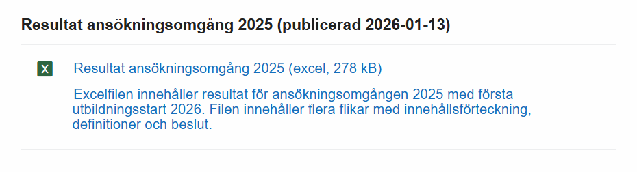
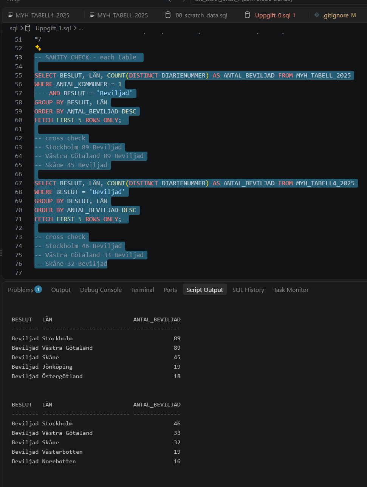
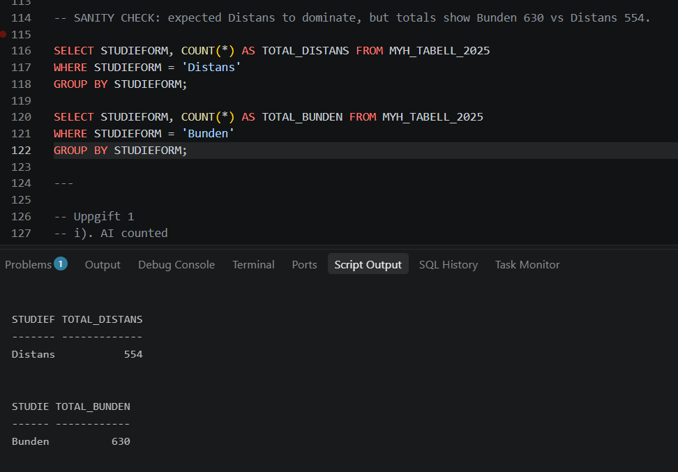
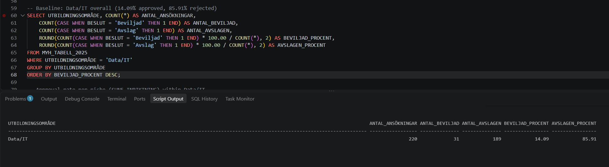
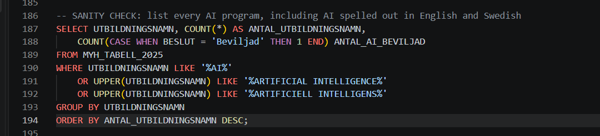
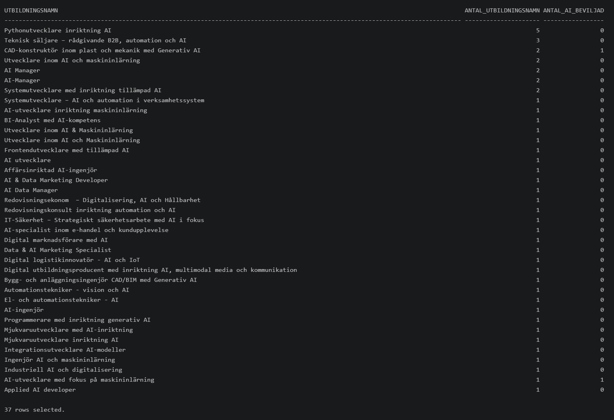

# The Skool – SQL analysis of MYH applications 2025

SQL analysis project: loading MYH's 2025 application results into
Oracle Database and answering questions with SQL, to help the education
provider The Skool decide which programs to apply for.

## Uppgift 0 – Uppvärmning
Code: [sql/Uppgift_0.sql](sql/Uppgift_0.sql)
- ✅ a) Repo: `the_skool_johan_v` (surname shortened for privacy)
- ✅ b) [.gitignore](.gitignore)
- ✅ c) Data from MYH: [data/resultat-ansokningsomgang-2025.xlsx](data/resultat-ansokningsomgang-2025.xlsx)
- ✅ d) Tabell 3 kept: [data/resultat_2025_tabell3.csv](data/resultat_2025_tabell3.csv)
  - **Deliberate deviation:** Tabell 4 is also kept: [data/resultat_2025_tabell4.csv](data/resultat_2025_tabell4.csv).
    Tabell 3 groups applications that run in several kommuner under `LÄN = 'Flera kommuner'`.
    Tabell 4 lists those applications per kommun, which is needed to place them in a län for Uppgift 1 g).
- ✅ e) Load into Oracle: [sql/Uppgift_0.sql](sql/Uppgift_0.sql)
- ✅ f) One script per task: see the [sql/](sql/) folder
- ✅ Extra: data cleaning (extra spaces removed from 130 values in Tabell 3 and 80 in Tabell 4), also in [sql/Uppgift_0.sql](sql/Uppgift_0.sql)

The data comes from MYH's "Resultat ansökningsomgång 2025" Excel file (published 2026-01-13).
Only the sheets Tabell 3 and Tabell 4 were exported to CSV and loaded.

The [.gitignore](.gitignore) excludes OS files (Linux, macOS, Windows), editor files and my scratch SQL file,
so only the finished scripts are in the repo.

## Uppgift 1 – Grundläggande EDA
Code: [sql/Uppgift_1.sql](sql/Uppgift_1.sql)
- ✅ a) Applications per education area, sorted most first [a)-c)](sql/Uppgift_1.sql#L9-L14)
- ✅ b) Approved applications per education area [a)-c)](sql/Uppgift_1.sql#L9-L14)
- ✅ c) Rejected applications per education area [a)-c)](sql/Uppgift_1.sql#L9-L14)
- ✅ d) Approved per program name within Data/IT [d)-e)](sql/Uppgift_1.sql#L18-L24)
- ✅ e) Rejected per program name within Data/IT [d)-e)](sql/Uppgift_1.sql#L18-L24)
- ✅ f) Approved per provider + program name within Data/IT [f)](sql/Uppgift_1.sql#L28-L33)
- ✅ g) Top 5 län by approved applications [g)](sql/Uppgift_1.sql#L79-L88)
- ✅ h) Share of distance vs classroom per area [h)](sql/Uppgift_1.sql#L105-L112)
- ✅ i) Number of programs containing "AI" [i)](sql/Uppgift_1.sql#L128-L132)

**Key results**
- a) Most applications: Ekonomi, administration och försäljning (239), Teknik och tillverkning (221), Data/IT (220).
- g) Top 3 län: Stockholm 135, Västra Götaland 122, Skåne 77. Uses Tabell 4 and `COUNT(DISTINCT DIARIENUMMER)`,
  so an application running in 2 kommuner in the same län is only counted once.
- h) Overall: Bunden 630, Distans 554.
- i) 48 applications have "AI" in the name (37 unique program names).

g) Top 5 län after combining Tabell 3 and Tabell 4 and counting each application once:

Sanity check for h): I expected Distans to dominate, so I counted each study format separately.
The totals (Bunden 630, Distans 554) add up to all 1184 applications.

## Uppgift 2 – Intervju
Source: my notes from the interview, supplemented with a classmate's shared notes.
- ✅ Interview with domain expert (2026-10-21): our course teacher, playing a
  representative of The Skool, a fictional education provider used as the case for this lab.

**Key insight:** The Skool wants to understand the **competitive landscape**:
which areas and programs are most likely to get funded, who the competition is,
and where a new academy can find an edge.

### What The Skool wants
- Compare Bunden and Distans: classroom vs distance, i.e. digital.
- See the competitive landscape: which providers apply, and in which areas.

### Open questions
- It costs a lot of money to apply, so they need to know what to apply for.
- Data/IT is applied for a lot, and the expert thinks parts of it are already full.
  As a new academy, maybe we can look at other areas within Data/IT, or other programs.
- Can we make a course more attractive with more AI-related programming?
- Differences between Distans and Bunden: is the approval rate higher for one of them?

### How it connects to the data
- Baseline: 1184 applications. The 39% approval rate is the baseline every area is compared against.
  - 462 approved (39%)
  - 721 denied (61%)
  - 1 withdrawn (0.1%). I checked `BESLUT` for values other than approved
    and denied, and found this one.
- Approval rate per area: `BESLUT` per `UTBILDNINGSOMRÅDE`, always shown with counts.
- Niches within Data/IT: grouped by `SUN5_INRIKTNING`. I chose the code over
  `SUN5_INRIKTNING_NAMN` because names can be misspelled in many ways (human error).
- Competitors: `UTBILDNINGSANORDNARE_ADMINISTR`.
- AI: `UTBILDNINGSNAMN`.
- Distans vs Bunden: `STUDIEFORM`.
- Tabell 4 is only needed to find which län the "Flera kommuner" applications run in.

## Uppgift 3 – Datadrivna beslut
Code: [sql/Uppgift_3.sql](sql/Uppgift_3.sql)
- ✅ Q1: Approval rate per area. Data/IT has the lowest of all areas: 14.09% vs the 39.02% baseline
- ✅ Q2: Bunden vs Distans. Bunden is approved more often (42.54% vs 35.02%), so lean towards Bunden
- ✅ Q3: Niches within Data/IT. Apply for IT-säkerhet (481xf, 21% on 33 applications);
  avoid webbutvecklare (481af, 0 of 32)
- ✅ Q4: Providers within Data/IT. Jensen has the most applications of any single unit (15) but 0 approved;
  Nackademin got 7 of 12 (58%). Counted per company, EC Utbildning (24) and IT-Högskolan (23) apply the most
- ✅ Q5: AI in the program name. Approved less often, but the overall 4% vs 40% is misleading:
  most AI applications are in Data/IT. Within Data/IT it's 3.3% vs 15.8%

Q3/Q4 baseline: Data/IT has 220 applications and 31 approved (14.09%). Every niche and provider is compared against this.

Q5 sanity check: every program with AI in the name, including AI spelled out in English and Swedish.
37 unique names, and only 2 applications approved in total.

**Key insight:** Applying a lot doesn't mean getting approved. Small groups can look
great by luck, so I always show the number of applications next to the percentage
and compare against a baseline (the average).

- [sql/Uppgift_3.sql](sql/Uppgift_3.sql): queries and analysis ideas are my own. LLM used for hints on SQL errors,
  pointing out that Q1/Q2 had swapped queries, the CASE/ELSE hint in Q5, flagging the Data/IT confounding in Q5,
  the missing 481ag niche in Q3 and company-level grouping in Q4, and wording the conclusions and comments.

## Uppgift 4 – Datamodell (BONUS)
- ⬜ Implement the data model (split the flat table into smaller tables)
- ⬜ Answer the Uppgift 1 questions again using the new tables

## Uppgift 5 – README
- ✅ This file

## Uppgift 6 – Video + slides
- ⬜ Presentation (PDF): ...
- ⬜ Video (5–10 min): ...

## Tools
- Oracle Database 26ai Free (run in rootless Podman on Oracle Linux 10)
- SQLcl (for `LOAD` and running scripts)
- VS Code with Remote-SSH + Oracle SQL Developer extension

## How to run
1. Start Oracle Database (Podman) and connect with SQLcl or SQL Developer.
2. Change the CSV path in [sql/Uppgift_0.sql](sql/Uppgift_0.sql) to where you cloned this repo.
3. Run `Uppgift_0.sql` (load + clean, expect `COUNT(*) = 1184`), then `Uppgift_1.sql`.

Note: `DROP TABLE IF EXISTS` requires Oracle 23ai or later.
The raw CSV is never modified; the scripts rebuild the table `MYH_TABELL_2025` from it.

## LLM usage
LLM (Claude) used as a sounding board ("bollplank"), noted in each file where used:
- Environment setup (Podman mount)
- [sql/Uppgift_0.sql](sql/Uppgift_0.sql): load script drafted with LLM, reviewed by me;
  cleaning blocks 5–18 generated from my own 4-column pattern
- [sql/Uppgift_1.sql](sql/Uppgift_1.sql): f) sorting fix (ORDER BY provider, program) suggested by LLM;
  g) ORDER BY fix (sort by count DESC), and LLM flagged the duplicates and corrected my `COUNT(DISTINCT)` placement;
  i) LLM confirmed case-sensitive `'%AI%'` avoids false positives like "sustainable"
- `.gitignore`: generated with gitignore.io for Linux, macOS and Windows, plus my scratch SQL file
  (kept as a private playground). nano was added on suggestion, and the Vim section removed because
  its swap-file pattern also matches `.sql` files.
- Uppgift 2: wording and structure tidied with LLM help; the content is from my interview notes.
- README and SQL comments: wording and structure tidied with LLM help.

## Sources
- MYH: [Resultat ansökningsomgång 2025](https://www.myh.se/yrkeshogskolan/resultat-ansokningsomgangar/resultat-for-program)
- Course material: [oracle_sql_course](https://github.com/AIgineerAB/oracle_sql_course)
  (lectures 04 load_csv, 05 filtering, 06 crud, 07 aggregation, 08 strings)
- Alexander Obregon, Substack: TRIM and the `UPDATE ... WHERE col <> TRIM(col)` pattern
- Interview Query: [SQL COUNT CASE WHEN](https://www.interviewquery.com/p/sql-count-case-when).
  Learned to turn 'Beviljad' into a 1 so it can be counted, used for several counts side by side
  (Uppgift 1 a–e) and for approval % (`Beviljad * 100.0 / COUNT(*)`). See [Notes.md](Notes.md).